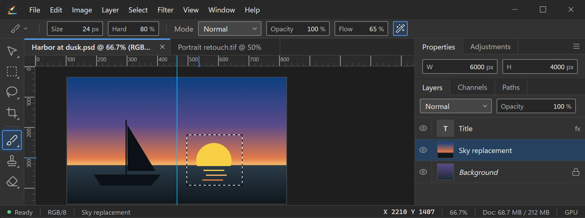
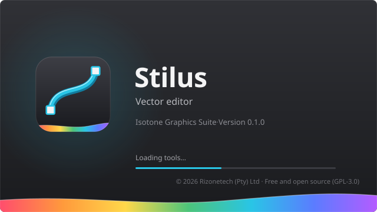
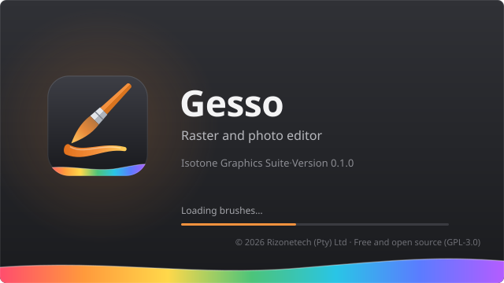
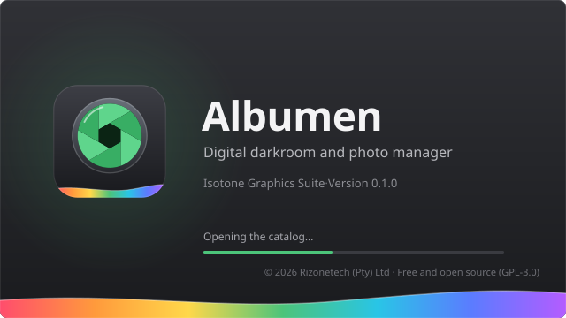
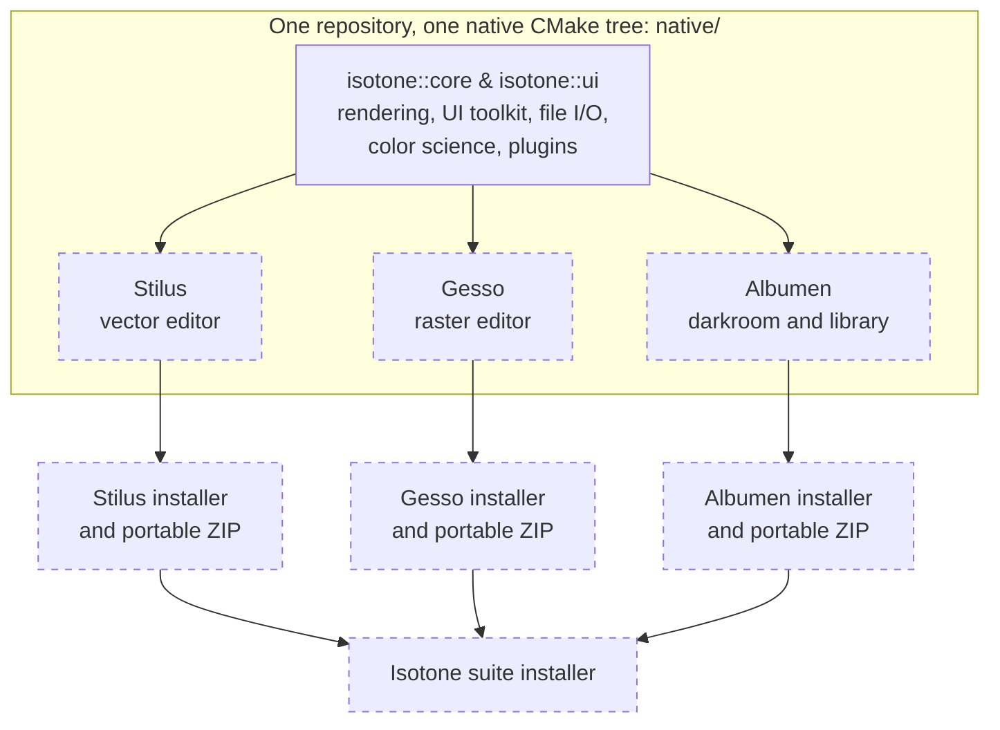

<div align="center">

<a href="https://www.rizonesoft.com/?utm_source=github&utm_medium=readme-logo">
  <picture>
    <source media="(prefers-color-scheme: dark)" srcset="resources/brand/isotone-wordmark-on-dark.svg">
    <source media="(prefers-color-scheme: light)" srcset="resources/brand/isotone-wordmark-on-light.svg">
    
  </picture>
</a>

<br>
<br>

<p>Six native Windows creative apps, one shared core: a vector editor, a raster editor, a digital darkroom, a color studio, a screen capture tool, and a page layout app.<br>Free, open source, and yours to keep.</p>

[](https://github.com/rizonesoft/Isotone/actions/workflows/build.yml)
[](https://github.com/rizonesoft/Isotone/actions/workflows/plan.yml)
[](https://github.com/rizonesoft/Isotone/actions/workflows/release.yml)
[](https://github.com/rizonesoft/Isotone/releases)
[](https://www.rizonesoft.com/?utm_source=github&utm_medium=readme-badge)
<br>
[](LICENSE)
[](docs/specs/2026-10-22-native-stack-design.md)
[](https://jrsoftware.org/isinfo.php)
[](#download-and-install)

<br>



<sub><i>Design concept, not a screenshot: the target interface from the Isotone Interface design system. The apps do not look like this yet; each surface is built to this design as its plan section ships.</i></sub>

</div>

**Design:** [Isotone Interface design system: themes, controls, and app icons](https://rizonesoft.github.io/Isotone/design/), a live page generated from [`docs/design/`](docs/design/README.md).

> [!NOTE]
> **Status: pre-alpha.** There is no release yet. The C++23 foundation (`isotone::core`, pinned toolchain, vcpkg baseline, AddressSanitizer, and libFuzzer) is live on `main`, and the earlier imported prototypes of Stilus and Gesso are preserved at the `csharp-final` Git tag as behavior references while the native apps build out. Everything below marks what works and what is on the roadmap. Star or watch the repository to hear about the first preview.

## Contents

- [Why Isotone](#why-isotone)
- [The suite](#the-suite)
- [Features](#features)
- [Architecture](#architecture)
- [Download and install](#download-and-install)
- [Build from source](#build-from-source)
- [Versioning and releases](#versioning-and-releases)
- [Roadmap](#roadmap)
- [Contributing](#contributing)
- [License](#license)
- [Acknowledgements](#acknowledgements)

## Why Isotone

Professional graphics software has drifted toward subscriptions, sign-ins, and cloud lock-in. Isotone goes the other way.

- **Own your tools.** No account, no subscription, no telemetry required to open a file.
- **Native and fast.** Built directly for Windows 11 in C++23 on Win32, Direct2D, DirectWrite, and Direct3D, with startup time, memory footprint, and responsiveness treated as features.
- **Open formats first.** SVG, PNG, TIFF, and JPEG are first-class citizens, with import paths for the formats you already have.
- **One family, three tools.** Each app installs and updates on its own, yet they share a core so colors, rendering, and plugins behave the same everywhere.
- **Free software.** GPL-3.0, developed in the open.

## The suite

<table>
  <tr>
    <td width="33%"></td>
    <td width="33%"></td>
    <td width="33%"></td>
  </tr>
  <tr>
    <td><strong>Vector editor.</strong> Structure and design: precision illustration, typography, logos, scalable graphics. An Illustrator alternative.</td>
    <td><strong>Raster editor.</strong> Creation and manipulation: painting, retouching, layer composition, pixel-level editing. A Photoshop alternative.</td>
    <td><strong>Digital darkroom and asset manager.</strong> RAW development, non-destructive edits, batch adjustments, library management. A Lightroom, ACDSee, and IrfanView alternative: a fast image viewer, browsing without importing, and batch tools.</td>
  </tr>
  <tr>
    <td>Targets <code>.svg</code>, <code>.eps</code>, <code>.ai</code>, <code>.pdf</code></td>
    <td>Targets <code>.psd</code>, <code>.png</code>, <code>.tiff</code>, <code>.jpg</code></td>
    <td>Camera RAW in, hands off to Gesso</td>
  </tr>
  <tr>
    <td>🚧 <strong>Native rewrite in progress</strong><br>Behavior reference preserved at <code>csharp-final</code></td>
    <td>🚧 <strong>Native rewrite in progress</strong><br>Behavior reference preserved at <code>csharp-final</code></td>
    <td>⚪ <strong>Planned</strong><br>Not started</td>
  </tr>
</table>

<sub>The cards above are the apps' splash designs, not screenshots. Real screenshots arrive with the first preview builds.</sub>

## Features

Legend: ✅ works today · 🚧 in progress · 📋 planned

### Stilus (vector editor)

Stilus began life as the Bezier project and was imported here with its full history (preserved at the `csharp-final` Git tag as the behavior reference for the native C++23 implementation).

| Area | Status | Notes |
| ---- | :----: | ----- |
| SVG import and export | 🚧 | Open, edit, and save SVG documents (reference implementation at `csharp-final`) |
| Drawing tools | 🚧 | Pen (Bezier curves), line, rectangle, ellipse, text |
| Editing tools | 🚧 | Select, node edit, pan, zoom |
| Layers | 🚧 | Layer panel with ordering |
| Undo and redo | 🚧 | Command-based history (move, resize, rotate, scale, group, reorder, property edits) |
| Alignment and snapping | 🚧 | Align selections, snap while drawing |
| Raw SVG view | 🚧 | Inspect and edit the markup directly |
| EPS, AI, and PDF import and export | 📋 | Target formats, not yet implemented |
| Shared `isotone::core` & `isotone::ui` | 🚧 | Shared C++23 core and UI toolkit under `native/` |

### Gesso (raster editor)

| Area | Status | Notes |
| ---- | :----: | ----- |
| Domain model | 🚧 | Documents, layers, masks, selections, tiles, history, color types |
| Application shell | 🚧 | Native Win32/Direct2D window, menus, and docking panels (`isotone::ui`) |
| Tiled rendering pipeline | 📋 | Designed for very large images |
| Painting and retouching tools | 📋 | Brush, eraser, selection, clone |
| Filters and adjustment layers | 📋 | Non-destructive by design |
| PNG, JPEG, TIFF, PSD | 📋 | Target formats |
| Plugins and scripting | 📋 | Out-of-process plug-in host and automation planned |

### Albumen (digital darkroom, photo manager, and fast image viewer)

| Area | Status | Notes |
| ---- | :----: | ----- |
| RAW decoding and development | 📋 | Non-destructive processing |
| Library and catalog | 📋 | Import, browse, rate, tag |
| Batch adjustments | 📋 | Apply settings across a selection |
| Edit in Gesso | 📋 | Send a developed image straight to Gesso |
| Fast image viewer | 📋 | `AlbumenViewer.exe`, the default viewer for any image |
| Browse without importing | 📋 | Open any folder, no import step |
| Batch tools | 📋 | Rename, convert, resize, and develop in bulk |

### Three more apps, after the first suite release

| App | What it is | Status |
| --- | ---------- | :----: |
| Tinctura | A color picker and color studio: a system-wide eyedropper, every color space, palettes and harmonies, contrast and color-blindness checks | 📋 |
| Capio | A screenshot and screen recording app: every capture mode, a full annotation editor, OCR, pin to screen, and recording to MP4 and GIF | 📋 |
| Folium | A page layout and publishing app, an InDesign alternative | 📋 |

## Architecture

Isotone follows one rule: **develop together, distribute separately.** All apps live in one repository and one native CMake tree (`native/`) so shared code can be refactored in a single change and debugged end to end. Each app compiles into its own standalone native executable statically linking its own copy of `isotone::core` and `isotone::ui`, so updating Gesso can never break an installed Stilus.



<sub>Dashed boxes are planned. Today <code>native/core/</code> holds <code>isotone::core</code>'s foundation; <code>isotone::ui</code> and the native apps arrive as their plan sections ship (the imported prototypes remain readable at the <code>csharp-final</code> Git tag).</sub>

**Shared core and UI responsibilities:**

- **Rendering and UI toolkit:** GPU-accelerated 2D/3D rendering and custom UI controls (`isotone::ui`) on Win32, Direct2D, DirectWrite, and Direct3D.
- **File I/O:** one place for bounds-checked, fuzz-tested format readers and atomic writers.
- **Color science:** shared color management so a color looks the same across the suite.
- **Plugin system:** an isolated out-of-process host so filters and extensions work safely across apps.

<details>
<summary><strong>Technology stack</strong></summary>

| Piece | Choice |
| ----- | ------ |
| Language | C++23 (`/std:c++23preview`, MSVC + CMake + Ninja, pinned in `native/toolchain.json`) |
| UI | `isotone::ui` -- custom native UI toolkit on Win32, Direct2D, DirectWrite, and Direct3D |
| Packages | vcpkg manifest mode, static linkage on the static CRT (`/MT`), audited in `docs/dev/native-libraries.md` |
| Tests & Analysis | GoogleTest (CTest), libFuzzer + AddressSanitizer, `clang-tidy`, `clang-format`, MSVC `/analyze` |
| Installers | Inno Setup 7 (64-bit Setup) and standalone portable ZIPs |
| Versioning | Semantic Versioning derived directly from Git tags |
| Platform | Windows 11, x64 and ARM64 (Windows 10 22H2 best-effort, unsupported) |

</details>

<details>
<summary><strong>Repository layout</strong></summary>

| Path | What it holds |
| ---- | ------------- |
| `native/` | The C++23 suite: `isotone::core`, `isotone::ui` (planned), the apps (planned), vcpkg manifest and triplets, CMake presets, and GoogleTest/libFuzzer suites |
| `docs/` | User and developer documentation ([index](docs/README.md)) and the [Isotone Interface design system](docs/design/README.md) |
| `todo/` | The development plan and TODO tree ([implementation plan](todo/implementation-plan.md)) |
| `installer/` | Inno Setup scripts, one per app plus the suite |
| `scripts/` | Build, check, toolchain, review, and packaging scripts |
| `tools/` | Toolchain provisioning and Git hooks |
| `resources/` | Brand art, icons, and shared assets |

</details>

## Download and install

> [!IMPORTANT]
> No builds have been published yet. This section describes how releases will ship.

**Download from [rizonesoft.com](https://www.rizonesoft.com/?utm_source=github&utm_medium=readme-download).** Installers and portable ZIPs are published only there, served from `download.rizonesoft.com`, never attached to GitHub. Each [GitHub release](https://github.com/rizonesoft/Isotone/releases) carries the release notes, the source code of that tag, the SHA-256 checksums, and links to the files on `download.rizonesoft.com`, so you can check what you downloaded. Once the first release exists, its files live at `https://download.rizonesoft.com/<app>/<version>/` (for example `https://download.rizonesoft.com/stilus/0.1.0/`).

Every app ships on its own, in two forms:

| Form | Best for | Notes |
| ---- | -------- | ----- |
| **Installer** (`.exe`, Inno Setup) | Most people | Start menu entry and a clean uninstall |
| **Portable ZIP** | Locked-down machines, trying it out | Unzip and run, no installer needed |
| **Suite installer** | Getting everything at once | One Isotone Graphics Suite installer with a component per app |

**Per-user or all-users.** The installer asks at startup. A per-user install needs no administrator rights and lands in your profile; an all-users install needs elevation and lands in Program Files.

**Zero external runtime needed.** Every executable links the C runtime and third-party libraries statically and imports only Windows system DLLs.

**Requirements:** Windows 11 (23H2 or later), 64-bit (x64 or ARM64). Windows 10 22H2 may work but is unsupported, and the installer says so before it continues.

**Package managers:** winget packages are planned after the first stable release; their manifests will point at `download.rizonesoft.com`.

## Build from source

<details open>
<summary><strong>Prerequisites</strong></summary>

- Windows 11 (23H2 or later), x64. Windows 10 22H2 may work but is unsupported.
- **Visual Studio 2026 (18.11 or later)** with the C++, ARM64, CMake/Ninja, Clang, Windows 11 SDK 26100, vcpkg, and AddressSanitizer components pinned in [`native/toolchain.json`](native/toolchain.json).
- [PowerShell 7](https://learn.microsoft.com/powershell/scripting/install/installing-powershell-on-windows) (`pwsh`) and Python 3 (`python`)
- [Git](https://git-scm.com/)
- Optional: [Inno Setup 7.1](https://jrsoftware.org/isinfo.php) or newer to build installers locally (`tools/provision.ps1` installs it)

</details>

```powershell
git clone https://github.com/rizonesoft/Isotone.git
cd Isotone

pwsh tools/provision.ps1                                                                   # verify the native toolchain, install Python icon deps, hooks, and Inno Setup
pwsh scripts/dev-env.ps1 -Arch x64 -Run 'Push-Location native; cmake --workflow --preset x64-debug'   # configure, build, and run GoogleTest
pwsh scripts/check-all.ps1                                                                 # run every gate: native presets, sanitizers, tidy, and plan checks
pwsh scripts/package.ps1 -App Stilus                                                       # produce the Stilus installer and portable ZIP (once native Stilus ships)
```

Full details, including troubleshooting, presets, and CI, live in [docs/dev/build.md](docs/dev/build.md) and [native/README.md](native/README.md).

## Versioning and releases

Each app is versioned independently with [Semantic Versioning](https://semver.org/). Versions come directly from Git tags, so there is no version number to edit by hand.

| Tag | Releases |
| --- | -------- |
| `stilus-vX.Y.Z` | Stilus |
| `gesso-vX.Y.Z` | Gesso |
| `albumen-vX.Y.Z` | Albumen |
| `isotone-vX.Y.Z` | The suite installer |

Pushing a tag builds and packages that app's installer and portable ZIP, uploads them to `download.rizonesoft.com`, and publishes a GitHub release with the notes, checksums, and download links. Changes are recorded per app in [CHANGELOG.md](CHANGELOG.md). See [docs/dev/versioning.md](docs/dev/versioning.md) for the full scheme.

## Roadmap

Development is driven by a TODO tree in [`todo/`](todo/), with the ordered plan in [todo/implementation-plan.md](todo/implementation-plan.md). In broad strokes:

1. **Foundation:** one native C++23 CMake tree, pinned toolchain and vcpkg baseline, static analysis, sanitizers, fuzzing, CI, installers, and release automation.
2. **Stilus preview:** build the native vector editor and ship the first public build.
3. **Stilus parity:** bring Stilus to parity with Adobe Illustrator 30.8 and CorelDRAW Graphics Suite 2026 (v27.2), every feature of both, in ten releases from 0.2.0 to 1.0.0. The [parity catalog](docs/parity/stilus-parity.md) routes each of their 4,335 inventory rows to a planned section, an existing one, the backlog, an exclusion (scripting, cloud services), or another Isotone app. Stilus AI runs on OpenRouter with your own API key (BYOK), sends nothing without an explicit action, and rests on three pillars: results are editable, undoable vector objects; brand kits and hand-offs work across the suite; and every AI action is recorded so it can be re-run, compared, and reverted.
4. **isotone::core and isotone::ui:** the shared native libraries grow the UI toolkit, pixel engine, color management, and AI core with the Stilus parity work, the pixel engine extensions and the develop engine with the Gesso parity work, and take rendering, file I/O, and other code as a second app needs it.
5. **Gesso preview:** canvas, layers, core tools, and PNG, JPEG, and TIFF support in `gesso-v0.1.0`.
6. **Gesso parity:** bring Gesso to parity with Adobe Photoshop 27.10 (with Camera Raw 18.6) and two other popular raster editors, Affinity by Canva 3.3 (Affinity Photo) and GIMP 3.2.6, every feature of all three, in twelve releases from 0.2.0 to 1.0.0 (Phases 16 to 27 of the plan). The [Gesso parity catalog](docs/parity/gesso-parity.md) routes each of their 10,829 inventory rows to a planned section, an existing one, the backlog, an exclusion (cloud services, platform-only and vendor-removed features), or another Isotone app. Gesso AI rests on the same three pillars as Stilus AI. Scripting and macros (one suite-wide system), batch processing, video, and animation are deferred to after the first release.
7. **Albumen preview:** library, RAW development on the suite develop engine, and the Edit in Gesso handoff in `albumen-v0.1.0`.
8. **Albumen parity:** bring Albumen to parity with Adobe Lightroom Classic 15.5.1, ACDSee Photo Studio Ultimate 2027, and IrfanView 4.76, in ten releases from 0.2.0 to 1.0.0 (Phases 30 to 39 of the plan), on three pillars: a fast default image viewer (`AlbumenViewer.exe`, opening any image from Explorer within a recorded startup budget), browsing any folder without importing it, and batch rename, convert, resize, edit, develop, and export as core tools. The [Albumen parity catalog](docs/parity/albumen-parity.md) routes each of their 8,919 inventory rows to a planned section, an existing one, the backlog, an exclusion (cloud services), or another Isotone app (ACDSee's layered Edit mode goes to Gesso). Originals are safe by default: Albumen writes into an original only when you opt in, and then only after a verified backup. Faces are recognized on your machine and never sent anywhere; tethered capture is replaced by watched-folder import for now.
9. **Distribution:** signing, win-arm64, winget, and the first suite bundle, `isotone-v1.0.0`.
10. **After the first release:** Tinctura, Capio, and Folium, RAW and XCF imports on the shared decoders, suite automation (actions, scripting, the command line, batch), video and audio with animation, on-device models and the GPU develop path, and Albumen's remaining formats, bundled as `isotone-v1.1.0`.

The plan file is the source of truth; this list is a summary and may lag behind it.

## Contributing

Contributions are welcome, from bug reports to pull requests.

- Read [CONTRIBUTING.md](CONTRIBUTING.md) for the workflow, commit style, and sign-off terms.
- The names and icons are covered by the [trademark policy](TRADEMARKS.md): a modified version you distribute needs its own name and icons.
- Report bugs and request features through [Issues](https://github.com/rizonesoft/Isotone/issues/new/choose).
- Ask questions and share ideas in [Discussions](https://github.com/rizonesoft/Isotone/discussions).
- Report security problems privately, as described in [SECURITY.md](SECURITY.md).
- Everyone taking part follows the [Code of Conduct](CODE_OF_CONDUCT.md).
- UI work follows [standards/ui.md](standards/ui.md) and the [Isotone Interface design system page](https://rizonesoft.github.io/Isotone/design/) (source: [`docs/design/`](docs/design/README.md)).

More documentation: [docs/](docs/README.md) · [user guides](docs/user/README.md) · [developer guides](docs/dev/README.md).

## License

Copyright (C) 2025-2026 Rizonetech (Pty) Ltd

Rizonesoft is a brand of Rizonetech (Pty) Ltd.

The Isotone Graphics Suite is free software: you can redistribute it and/or modify it under the terms of the **GNU General Public License version 3** as published by the Free Software Foundation. It is distributed in the hope that it will be useful, but without any warranty. See [LICENSE](LICENSE) for the full text. The GPL covers the code; the names "Rizonesoft", "Isotone Graphics Suite", "Stilus", "Gesso", and "Albumen" and the app icons are trademarks of Rizonetech (Pty) Ltd, covered by the [trademark policy](TRADEMARKS.md).

Stilus and Gesso were previously published under the MIT License as separate projects by the same author, under the names Bezier and Imago. Both are now part of this repository and are licensed under GPL-3.0.

## Acknowledgements

Isotone stands on the shoulders of excellent open source work:

- [vcpkg](https://github.com/microsoft/vcpkg) for reproducible C++ package management
- [GoogleTest](https://github.com/google/googletest) and [Google Benchmark](https://github.com/google/benchmark) for testing and benchmarking
- [LLVM](https://llvm.org/) (`clang-format`, `clang-tidy`, and `clangd`) for formatting, static analysis, and language-server tooling
- [resvg](https://github.com/linebender/resvg) (`resvg-py`) and [Pillow](https://python-pillow.org/) for deterministic SVG icon and design-reference rendering
- [Inno Setup](https://jrsoftware.org/isinfo.php) for installers

<div align="center">
<sub>Made in the open by <a href="https://www.rizonesoft.com/?utm_source=github&utm_medium=readme-footer">Rizonesoft</a>, a brand of Rizonetech (Pty) Ltd.</sub>
</div>
